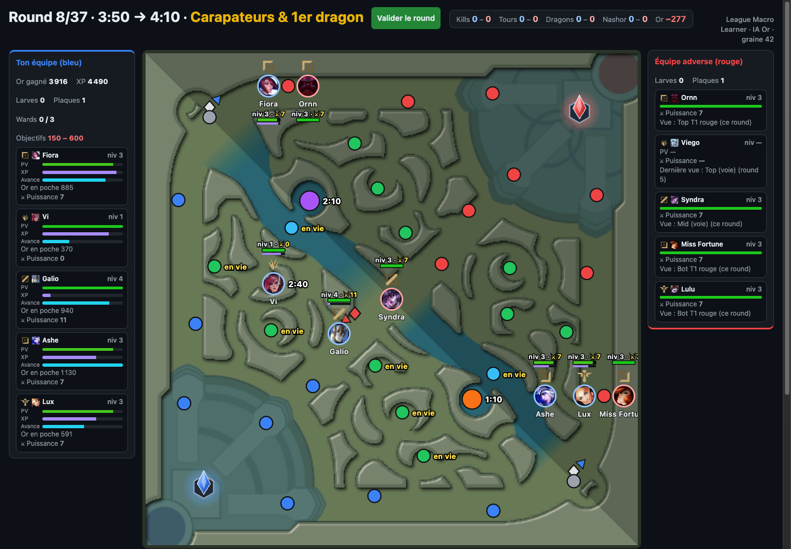

# League Macro Learner

A lightweight, turn-based web game for practicing **macro decision-making in League of Legends**: lane priority, rotations, objective control and map awareness.

> Status: playable vs-AI prototype. The rules below are still a draft and will be tuned through playtesting.



## Getting started

Requires [Bun](https://bun.com/).

```sh
bun install          # install the workspaces
bun run fetch-data   # optional: refresh champions and images from Data Dragon (outputs are committed)
bun run dev          # dev server, prints the URL to open
bun test             # engine, data and web tests
bun run typecheck    # TypeScript strict, all packages
bun run check-deps   # enforces the module boundaries (see Architecture)
bun run build        # static site in packages/web/dist
```

CI runs typecheck, check-deps, tests and build. For screenshots, the app (any build) accepts `?autostart=1&rank=gold&seed=42` to skip the start screen and launch a game directly.

## The idea

Each team is five tokens on a simplified Summoner's Rift: top, jungle, mid, ADC and support. Every turn, both sides secretly give an order to each of their five tokens, then the turn resolves at the same time for everyone, like simultaneous-move chess.

> *Recall top, jungle takes Herald, mid rotates to Herald, bot lane shifts mid.*

The goal is to learn to read the board: who has lane priority, who can rotate first, and which objective is worth contesting.

## Tempo

Tempo is the heart of the game. **Every round is a unit of time, and the team that wastes fewer rounds wins.**

- **Priority is tempo.** A laner who has pushed their wave is free to move this round. Their opponent has to stay and catch the wave, or lose gold and XP.
- **Every action has a time cost.** A recall, a death or a long walk across the map costs rounds. Recalling right after shoving a wave costs almost nothing, while recalling with the wave pushed in front of your tower costs a lot.
- **Arriving first wins.** When both teams move toward the same objective, the side that gets there first, or with more tokens, takes the fight or the objective.
- **Converting tempo.** A tempo lead only matters once you spend it on something: an objective, a tower, an invade or vision.

Teaching mode calls out tempo directly, for example: *"You lost 2 rounds: your mid recalled without pushing the wave."* *(design call)* These tempo costs come from a rule table in data (situation → rounds lost + explanation), checked against the round's events, not from simulating alternative plays.

## Core rules (draft)

- **Random draft.** Each game starts with a random draft of real champions for both teams.
- **Matchups matter.** Each lane matchup gives an advantage that changes across five stages of the game: *really early, early, mid, mid-late, late*. That advantage drives lane priority.
- **Map positions.** The map has 39 positions: each lane tower (T1, T2, T3) and lane middle, every jungle camp, the Baron and Dragon pits, both Scuttle Crabs, and the two bases. They are placed from real Summoner's Rift coordinates, on top of the official minimap from CommunityDragon.
- **Rounds.** A round is resolved once you have given and confirmed an order for each of your five champions.
- **Phases.** Neutral objectives (Scuttle Crab, Dragons, Voidgrubs, Herald, Baron) set the rhythm. The game is split into phases, and rounds cover less game time early and more game time later. Most of the advantage is decided before 25 minutes, so a game stops at 25:10, after 37 rounds.

| Phase | Game time | Round length | Rounds | Key events |
|---|---|---|---|---|
| 1. Level 1 & first clear | 1:30 → 3:30 | 20 s | 6 | lane priority, invades, end of first clear |
| 2. Scuttles & first Dragon | 3:30 → 6:10 | 20 s | 8 | Scuttle Crabs, first Dragon, Voidgrubs spawn |
| 3. Voidgrubs & plates | 6:10 → 14:10 | 40 s | 12 | Voidgrubs, Dragons, tower plates |
| 4. Herald & mid game | 14:10 → 20:10 | 1 min | 6 | plates drop, Herald, T1/T2 towers |
| 5. Baron | 20:10 → 25:10 | 1 min | 5 | Baron, Dragon Soul, T2/inhibitor towers |

The longer a round, the farther a token can move during it. Objective timers change between patches, so they live in data files.

- **Verdict.** There is no nexus to destroy for now. At the end of the game, the winner is the team with the bigger accumulated advantage: gold, objectives and towers.
- **Starting state.** Every laner starts in lane. Each jungler has already done its first buff when round 1 starts: it stands on that buff camp, the camp is cleared, and it has the buff's gold and XP. You know which camp the enemy jungler started on.
- **Death and recall.** A token that dies or recalls comes back next turn at a base position on its own half of the map. On that turn it can't invade or take an objective. In late game, a death also costs one extra turn.

## Fights

**Contact.** A contact happens when enemy champions end the round in the same **zone**. Only the arrival position counts, so champions who cross paths during the round between two zones don't meet. The zones are:

- a **lane**: its towers (T1 to T3 of both sides) and its middle;
- a **river**: the top one is the top Scuttle and the Baron pit, the bottom one the bottom Scuttle and the Dragon pit;
- each **jungle camp** on its own.

Bases are never contacts.

**Standard laning** (even numbers in a lane, and all of them home laners of that lane: 1v1 tops, 2v2 bot duos) resolves automatically from the stances (see *Lane contacts* below). Every other zone with both sides present pauses the resolution, and each player involved chooses to **fight** or **flee**, with a default already selected: the smaller side flees, otherwise it fights. Against the AI, the AI answers for its side. A round therefore has two steps: give the orders, then answer the contacts.

| Situation | Kind | Default choice |
|---|---|---|
| Even numbers in lane, all home laners | Lane trade (automatic) | Each side's **stance**. See *Lane contacts* below. |
| Ganked (an enemy **arrives** in your lane this round from elsewhere and outnumbers you; a laner coming back to its own lane is not a ganker) | Gank | **Flee** (the gankers: **fight**) |
| Outnumbered in lane without a gank (e.g. the enemy support roamed away, so it is 2v1) | Lane pressure | **Flee** (the bigger side: **fight**) |
| Anything else in a lane (e.g. both junglers join a 1v1) | Skirmish | Smaller side flees, otherwise fight |
| Both sides in a river | Objective | Smaller side flees, otherwise fight. See *Neutral objectives*. |
| An enemy camp | Invade | The invader can only fight |

**Where the fight happens.** On the position of the smaller side (the one with most of its champions if they are spread), or with even numbers on the zone position holding the most champions; remaining ties go to the lowest position id. In a lane, when nobody flees, every champion of the contact is moved onto that position, and a standing tower there counts for its defenders. *(design call)* Automatic lane trades and river contacts move nobody: in a river, each champion stays on the pit or the Scuttle it arrived on.

**Staying under your tower.** In a lane, a smaller side whose champions all stand on their own standing tower may also choose **farm**: it stays and farms at `economy.pressureFarmShare` (half) of a normal round. If the bigger side fights, each of them loses `fight.pressureHpLoss` (10) HP, and they die only if the bigger side wins by more than `aiTuning.allInMargin`.

- **Flee**: the champion survives and goes back to its previous position. On an objective, it gives the objective up. *(design call)* A champion who did not move this round (or just spawned there) retreats one step toward its base instead: along its lane to the next own tower (T1 → T2 → T3 → base), elsewhere to the neighbouring position closest to its base. It no longer defends the tile it left. A champion who flees or retreats **forfeits its action** this round: no camp, no Scuttle or objective, no farm. So does a champion whose recall a fight interrupted.
- An outnumbered side that flees a side that fights loses `fight.gankHpLoss` HP.
- **Fight**: the winner takes the objective or the kill. Losers **die**.
- If both sides flee, nobody takes the objective and it stays up for the next round. If one side flees and the other fights, the fighting side takes it without a fight.
- *(design call)* In lane, if one side flees and the other trades or fights, the side that stayed wins the trade (wave and lead).

**Lane pressure without a gank.** When a lane is uneven and nobody arrived from elsewhere (for example someone left it, or a laner walked back to its own lane), the contact is prompted like a gank, but the ganked side's exposure plays no part. The bigger side pushes the wave and hits the tower (plates). A smaller side that stays to farm under its tower farms at a reduced share (see *Staying under your tower*).

**Lane stance.** Each laner has a persistent **stance**, set once in its actions and kept until changed: **Farm** (default), **Trade** or **All-in**. Even lane contacts resolve automatically from both stances, with no prompt each round. The game only asks for a choice outside standard laning: a gank, an outnumbered lane, a skirmish, a contested river, an invade.

**Laners follow their wave.** A laner with no order stays in its lane on Farm (safe), and follows its lane's wave automatically: it stands where the wave is (in front of its tower, in the middle, or in front of the enemy tower) and farms.

**Lane pressure is computed.** Each lane's pressure comes from the matchup, the levels and the lead of the laners present. It pushes the wave. The map shows it as an arrow, which is **your estimate**: your champions as they are, and the enemies you see with the stats you would estimate for them (see *AI opponent*), never their true lead.

**Lane contacts.** With even numbers in lane, each side's stance decides, with no prompt. A stance is one of:

- **Push**: shove the wave: it moves one extra step toward the enemy tower and hits it harder, but the laner stands forward and is more exposed to ganks. In a lane contact it behaves like Farm (no all-in).
- **Farm** (default): play the lane normally, with no trade. The wave moves by matchup and lead, as when the laners don't meet.
- **Trade**: exchange spells without going for the kill. Nobody dies. The trade winner (fight score) gains lead and pushes the wave.
- **All-in**: go for the kill, which turns the contact into a fight where the losers die.

**Flee** is not offered on these automatic even-lane contacts: the stances decide. To leave the lane, give the laner another order.

Nobody can die in lane unless at least one side picks **All-in**, and a laner on **Farm plays safe**: in an even lane contact (1v1, 2v2) it never dies, even against All-in. The All-in side only wins the trade (wave and lead). Only a laner on Trade or All-in can be killed in an even lane. Ganks and outnumbered lanes stay dangerous. Farm against Trade is a trade. The AI only goes all-in with a large advantage (threshold in data).

**Invading** enemy jungle is a commitment, with no option to flee. If you meet an enemy and lose the fight, you die.

**Towers in a dive.** A fight on a position with a standing tower counts that tower as an extra **weak champion** on the defending side.

**Who wins.** Fights are **deterministic**: the same situation always gives the same result. In order of weight:

1. **Numbers**: the side with more champions has the upper hand, especially in early game.
2. **Lead**: a per-champion gauge of XP and gold, updated each round.
3. **Matchup**: the advantage of one champion against another, which depends on the game stage.
4. **Skirmish strength** or **teamfight strength**: a per-champion value that also depends on the game stage. A fight with **7 or more champions in total** (4v3 or bigger) is a teamfight. Anything smaller, up to 3v3, is a skirmish.

Game stages for matchups, skirmish and teamfight: *really early, early, mid, mid-late, late*.

**How the factors combine** *(design call, to tune in playtest)*. Each side gets a fight score, which is a weighted sum. Numbers carry by far the biggest weight, and that weight is highest in early game. Lead, matchup and skirmish or teamfight strength come after. In a fight with more than one champion per side, each matchup term is the average over the opposing champions that have a matchup row. All weights live in data.

- **The side with the higher score wins.** The **score gap** sets how many champions die on the losing side (`fight.deathGap` per death, data): a small gap can kill nobody, a large one kills everyone. The most wounded die first. Every losing survivor loses HP. Winners gain gold and XP for each kill. Losers who survive a fight retreat (like a flee), leaving the spot to the winners.
- **Ganks and lane position.** A ganked laner's position on its wave matters: pushed toward the enemy tower it is exposed (bonus to the gankers), in the middle it is neutral, under its own tower it is protected (the tower already helps the defenders). A gank that kills nobody still costs the ganked champions HP.
- **On an exact tie**, nobody dies and both sides go back to their previous position.

**HP is visible.** Every HP loss shows in the log (yours, and the enemies you see after the round). A champion who lost HP this round does not regenerate at its end.

## Lanes and towers

**Waves.** Each lane has a wave position: near the blue tower, in the middle, or near the red tower. The wave state is **deterministic**, like a fight:

- When both laners stay in lane, the matchup and the lead decide where the wave goes.
- When one side gets more champions in the lane, the wave is pushed.
- When a laner leaves their lane, their wave pushes toward their tower and the enemy laner gains lead. If that enemy also had matchup pressure, the tower loses some HP.
- *(design call)* "Near the tower" always means the side's **frontmost standing tower** in that lane. When a T1 falls, the wave fights at the T2.

**Towers.** Each tower has **5 HP**, and one HP is one plate.

- Each round of pushing on a tower removes HP based on how many champions push it:

  | Champions pushing | 1 | 2 | 3 | 4 | 5 |
  |---|---|---|---|---|---|
  | HP removed | 1 | 1 | 2 | 3 | 4 |

- The **Herald** removes **3 HP**.
- *(design call)* A tower only takes damage when the attacking side's wave is near it and at least one attacker is on its position. Defenders on the position fight the attackers first.
- *(design call)* There are no inhibitors or nexus as targets in this version, since the game stops at 25:10.
- **Voidgrubs** and **Baron** multiply tower damage (see [Neutral objectives](#neutral-objectives)).
- Plates give gold until 14:00.

## Neutral objectives

| Objective | Reward |
|---|---|
| **Scuttle Crab** | Gold for the champion who takes it, plus vision of the nearby pit (Dragon for the bottom Scuttle, Baron for the top one) This vision lasts like a normal ward and does not count toward the 3-ward limit. |
| **Dragon** | Lead for the whole team |
| **Voidgrubs** | Tower damage ×1.5 for the team, for the rest of the game |
| **Herald** | Picked up by the champion who takes it, then launched on a tower in a later round to remove 3 HP |
| **Baron** | Tower damage ×2 for the team for 3 rounds |

Tower damage bonuses stack: Voidgrubs plus Baron gives ×3. The Herald launch is an action the carrier picks at its tower position.

*(design calls, values in data)*
- Each objective has a minimum number of champions needed to take it. Starting values: 1 for Scuttle, Dragon, Voidgrubs and Herald, 3 for Baron.
- **Dragon, Voidgrubs, Herald and Baron take time.** You arrive on the pit one round and take the objective at the end of the next round, as long as you stay there. With **4 or more champions** on the pit, Dragon, Voidgrubs and Herald are taken on arrival. Baron always takes the extra round, even with 5 champions. In between, the enemy has a round to contest it. The Scuttle Crab is taken on arrival.
- Voidgrubs, Herald and Baron follow their real spawn timers from the current patch, stored in data. They share the Baron pit, each one replacing the previous.
- There is no Dragon Soul bonus. Each Dragon simply adds team lead.
- **The river is one grouped fight.** A champion with a step left on a pit starts or continues its objective. When the pit objective is taken, the river's Scuttle is taken in the same round if it is up, shared by the same champions. A champion on the Scuttle takes only the Scuttle and never starts the pit objective. Any enemy anywhere in the river contests both.
- **A contested river** offers each side **fight**, **flee**, and **keep taking the objective** (only to a side with a champion acting on the pit or the Scuttle):
  - *objective* against *flee*: the objective (and the Scuttle) proceeds;
  - *objective* against *fight*: a fight where the objective side's score is multiplied by `fight.objectiveFocus` (0.8); if it still wins, it takes the objective this round as well as the kills;
  - *objective* against *objective*: a race. The higher fight score keeps taking it and the other side leaves; nobody dies or loses HP. On a tie, both stay and nobody takes it.
  - A champion arriving on its last step (no action left) cannot choose the objective, but still fights.
- Jungle camps respawn on their real timers and give gold and XP to whoever clears them: one camp per round, the one the champion stands on with a step left (see [Movement](#movement)). `clearSpeed` no longer lets a jungler clear a second camp on the way.

## Lead, gold and recall

Each champion has a **lead gauge** made of two parts:

- **XP**: updated at the end of every round, from farming, kills and objectives.
- **Items**: gold piles up as you play, but it only turns into power when you **recall** and buy items.

*(design call)* The gauge is a single number: XP value plus the value of the items you own. Unspent gold is shown separately and only adds to the gauge on recall. Farming each round, kills, camps, plates and objectives all give XP and/or gold, with amounts in data.

**End-of-game verdict** *(design call)*: each team scores its gold (including the value of items) plus fixed values for each objective and each tower plate or tower. The values live in data. The higher score wins.

**Health.** Every champion has **100 HP**. A lost trade costs HP, the winner loses a little; a champion regains some HP every round; a recall or a respawn restores full HP. A wounded champion weighs less in fights. Values live in data.

**Death.** A champion who dies also spends its unspent gold on items, as on a recall.

Recalling is how you **cash in** your advantage. A champion sitting on a lot of gold is weaker than its gold says until it goes back to base. Picking the right moment to recall is a tempo decision: it costs rounds, but it turns gold into strength.

## Movement

The map positions form a graph, and a move is a walk of a few steps on it. Starting values:

- **Step budget**: every champion, laner or jungler, has the same number of steps per round, set by the round's length: 2 steps in 20 s rounds, 3 in 40 s rounds, 4 in 1 min rounds (`rules.moves.budgetBySeconds`; cap the 1 min value at 3 if it feels too mobile).
- **An action costs a step**: clearing a camp, taking a Scuttle, starting or continuing a pit objective, farming your lane's wave, and recalling all need a step left once you arrive. Staying where you are always leaves one.
- **Arrival only**: a position reached on the last step of the budget is reached, but nothing is done there that round. The champion still fights or flees there, and acts the next round by staying. For example, with 2 steps, a jungler going Gromp → Wolves arrives without clearing Wolves, and a laner arriving in its lane on its last step gets no farm that round.
- **Changing lane ends the move**: going from one lane to another (mid T1 → top or bot T1) is 1 step, and the champion stops there for the round.
- **Along a lane**: T3 – T2 – T1 – lane middle – enemy T1, one step each. There is no shortcut from a T1 to the enemy T1.
- **Lane to river**: the top Scuttle and the Baron pit are 1 step from the top T1s, the top lane middle, the mid lane middle and the blue mid T1 (and the red mid T1, by symmetry); the Scuttle and the pit are 1 step from each other. The bottom side mirrors it. So the mid lane middle reaches both Scuttles and both pits, and so does each mid T1.
- **River to jungle**: the top Scuttle is 1 step from blue Gromp, Blue Buff and Wolves, and from red Raptors, Red Buff and Krugs; the Baron pit is 1 step from blue Blue Buff and red Red Buff. The bottom side mirrors it.
- **Your own jungle**: Gromp – Blue Buff – Wolves and Raptors – Red Buff – Krugs. Crossing from one side to the other (e.g. Wolves → Krugs) goes through the mid T1.
- **Jungle to lanes**: Gromp → top T2 and T1, Blue Buff → top T1, Wolves → mid T2 and T1, Raptors → mid T1, Krugs → mid T1, bot T2 and T1, Red Buff → bot T1 (the red side mirrors it), so a jungler ganks its nearby lane from an outer camp.
- **Route**: a move is drawn and resolved along a shortest path. Among equal ones, each step prefers a lane position, then a camp, then the river.

- **Pit objectives** (Dragon, Voidgrubs, Herald, Baron) take one extra round, unless 4 or more champions are on them (except Baron, which always takes the extra round) (see [Neutral objectives](#neutral-objectives)).
- **Recall** is the action: it can follow a move that leaves a step of the budget (at most 1 step in 20 s rounds), and can place or clear a ward on the way, like a move (for example, step back under your tower, then recall). The champion recalls from where it ends, if it is not caught in a fight there, and respawns at a base position the next round, so a recall costs 1 round. Placing a ward is free: it costs no step.
- **Bases** are two more positions (Base blue and Base red), which brings the total to 39. *(design call)* A champion who respawns after death or recall picks a starting point: a laner picks the frontmost standing tower of the lane they choose, and a jungler picks a camp on their own side.

**Sacrificing a wave.** Leaving a lane while the wave crashes under your own tower costs the wave (gold, XP, possibly plates), but it can be the right play when it gives your team the numbers on a neutral objective. Teaching mode doesn't call this a mistake when the champion went to an objective that was up, about to spawn, or taken that round. It explains the trade-off instead, and higher AI ranks make this sacrifice when the objective is worth more than the wave.

These values live in data files and are a starting point, to be tuned through playtesting.

## Vision

Enemy champions are hidden in fog of war. You see an enemy champion only if it is:

- in the **same lane** as one of your champions, meaning any tower position or the middle of that lane,
- on the **same position** as one of your champions (a camp, a pit, a Scuttle…),
- on a position where you have a **ward**.

Vision is revealed when the round resolves, so you use what you saw this round to plan the next one. The enemy jungler's starting camp is visible only during the first round.

**Wards**

- A champion can place a ward in addition to its move, **either on its starting position or on its arrival position** (the player chooses).
- Each team can place up to **3 wards per round**.
- A ward placed in round N gives vision when round N+1 resolves, then fades once round N+1 is confirmed.
- First round: depending on their starting side, the jungler can place their ward at the **Blue Buff** or at the **Raptors**.

**Clearing wards**

- Only the **jungler** and the **support** can clear wards.
- Each team can clear **1 ward per round**, either on the champion's starting position or on its arrival position (the player chooses).
- A champion can place a ward and clear one in the same round, on the same position or not.

## Game screen

- **Round banner** (very top, large): round N/37, game time window of the round and phase. While you give orders it also holds a **Valider le round** button, so confirming never needs a scroll. **Enter** does the same when no field or button has the focus.
- **Scoreboard** (top centre, like League): kills blue – red, towers, Dragons and Barons per team, and the team **gold advantage** ("+1.2k" or "−800"). Kills, towers and objectives are public, as in the real game. The gold advantage is a learning aid and uses the enemy's real gold. It also feeds the estimates of enemies you can't fully see: the AI, the pressure arrows and the strength bars size an enemy on your own champion of the same role, with its items scaled by the gold ratio (see *AI opponent*).
- **Teams on the sides, like League**: your team in a column left of the map, the enemy team in a column right of the map. One card per champion with role icon, name, level, XP bar, lead bar and unspent gold (own team), or last seen position (enemy).
- **Above every visible token**: its HP bar, its power score (level and lead), its level and its XP bar, so you can compare yourself with a visible enemy. The team cards show the same, plus unspent gold for your own champions.
- **Center**: a flat map showing every playable position, with a tooltip on hover. One token per champion, with the official League role icon above it (from CommunityDragon) and its name below. Fog of war covers what you can't see. The map takes the full available height, and every position and token has a click target larger than its drawing.
  - Each neutral objective and jungle camp shows, on its own position, the time left before it spawns, or that it is up. A cleared camp is greyed out with its respawn timer.
  - Each lane shows its **wave** marker (near the blue tower, in the middle or near the red tower), so you can read lane priority.
- **Actions** (a small panel next to the selected token, opened on the side where it hides the fewest positions, and **draggable** by its title; it keeps its position between rounds): the selected token's options, including a laner's stance. Place a ward or clear one, each on the starting or arrival position. Recall.
- **Round summary** (below the map): current phase, round and game time, next objective spawn, the list of this round's orders, the **Confirm round** button, and teaching-mode explanations after the round resolves.
- **Contact prompts**: when a contact needs an answer during resolution, the fight or flee choices appear in an overlay docked on the map, next to the contacts.
- **After a round resolves**, the banner button becomes **Round suivant**, next to **Revoir le tour**.
- **Ward markers**: an eye icon on every position where your team has a ward, with the rounds it has left.
- **Round replay**: after a round resolves, a short animation (about 2 s, with replay and skip buttons) plays it on the map: visible tokens slide to their destination, fights flash, deaths and taken objectives appear. Only what you saw is shown. The text log stays below.
- **Giving orders**: click a token, and only the positions it can reach this round light up. Then click its next position. A dashed arrow shows the move. With no order, a laner standing in its home lane follows its wave; any other token stays where it is.

The clickable mockup [`docs/game-screen-mockup.html`](docs/game-screen-mockup.html) is the reference for this layout. It also holds the first draft of the position coordinates and the movement graph.

## Game modes

1. **vs AI.** A full game against a computer opponent. This is the first mode to build.
2. **vs human.** Two players give their orders simultaneously.
3. **Puzzles.** A preset mid-game situation where you have to find the winning play.
4. **Sandbox.** Set up any situation by hand: pick each champion, place it on any position, and set levels and advantages. It is meant for coaches, who can use it to explain a situation and then play it out.

**Teaching mode** can be turned on or off. When it is on, the game explains each turn's outcome, for example: *"The enemy mid had priority and rotated to Scuttle first, so it became a 2v1."*

## AI opponent

There are **10 difficulty levels**, named after League ranks: Iron, Bronze, Silver, Gold, Platinum, Emerald, Diamond, Master, Grandmaster, Challenger.

The AI always plays by the fog-of-war rules: it only knows what its own wards and champions see, plus the public scoreboard. For an enemy, it assumes the XP of the enemy's seen level, or else of its own champion of the same role, and that champion's items scaled by the scoreboard gold ratio (enemy gold earned over its own), plus the enemy's Dragon buffs. Your pressure arrows and strength bars use the same estimate. Lower levels don't play at random. They make the **macro mistakes typical of their rank**, and higher levels make them less and less often. Challenger almost always plays the best tempo move, but even Master+ makes a small mistake now and then.

Each level is a data profile with a frequency per mistake (for example, Iron greeds 60% of the time and Challenger 1%). Mistakes are random rolls, but fights and waves stay deterministic.

| Mistake | What it looks like | Iron–Bronze | Silver–Gold | Plat–Emerald | Diamond | Master+ |
|---|---|---|---|---|---|---|
| **Greed / overextend** | Stays shoved with no vision, keeps pushing a tower with the enemy missing | very often | often | sometimes | rarely | very rarely |
| **Objective timing** | Shows up late to a spawn, starts it without priority, forgets respawn timers | very often | often | sometimes | rarely | very rarely |
| **Pointless plays** | Fights or invades when nothing is up on the map | very often | often | sometimes | rarely | very rarely |
| **Chasing kills** | Picks fight over flee when outnumbered | very often | often | sometimes | rarely | very rarely |
| **Rotating without priority** | Leaves lane to help without the wave pushed | often | often | sometimes | rarely | very rarely |
| **Bad recall** | Recalls with the wave crashing into its own tower, right before a spawn, or sits on gold | often | often | sometimes | rarely | very rarely |
| **Poor vision** | Few wards, wards in useless spots, never clears wards | very often | often | sometimes | rarely | very rarely |
| **No conversion** | Wins a fight, then walks away without taking a tower or objective | often | sometimes | sometimes | rarely | very rarely |
| **Ignoring the enemy jungler** | Plays the same way whether or not the jungler was last seen nearby | very often | often | sometimes | rarely | very rarely |

**Laning phase.** Until 14:00 (plates), AI laners stay in their lane and follow their wave: the normal role and priority rotations to objectives are off for laners. Only the jungler roams. The exceptions are recalls and the Emerald+ wave sacrifice, limited to the pit on the laner's half of the map (top to the Baron pit, bot to the Dragon). The mid laner, as far from both pits, never sacrifices its wave in this phase: it only rotates with priority (its wave pushed toward the enemy tower). Mistakes (rotating without priority, pointless plays) can still break the rule.

At any time, the AI skips an objective when the enemies it knows near the pit would win the fight against the group it could bring there, instead of walking in only to flee.

Master, Grandmaster and Challenger keep a small mistake rate that goes down with each rank, and they also differ in how many rounds ahead they plan.

*(design call)* The AI is **rule-based**. It uses a library of macro heuristics (contest objectives with priority, recall on a shoved wave, track the jungler, convert leads) plus a board evaluation function, and each mistake is a switch on those rules. Master+ adds a shallow look-ahead of 1–2 rounds on its own candidate moves, without a full game-tree search.

## Data model

All values that are scored from 0–10 or -5 to +5 come as five numbers, one per game stage: *really early, early, mid, mid-late, late*.

**`champion`**

| Field | Example | Use |
|---|---|---|
| `id` | `LeeSin` | Riot Data Dragon key |
| `name` | `Lee Sin` | Display |
| `image` | `LeeSin.png` | Token on the map |
| `roles` | `[jungle]` | Playable roles, used by the random draft |
| `tags` | `[Fighter, Assassin]` | Class, used in teaching-mode explanations |
| `skirmish` | `[8, 8, 7, 5, 4]` | Skirmish strength per stage, 0–10 |
| `teamfight` | `[4, 5, 6, 5, 4]` | Teamfight strength per stage, 0–10 |
| `clearSpeed` | `7` | Junglers only: how fast they clear camps, 0–10 |
| `waveclear` | `3` | How well they push a wave, used as a tie-breaker, 0–10 |

**`matchup`** (top, jungle, mid)

| Field | Example | Use |
|---|---|---|
| `lane` | `top` | |
| `champion` / `opponent` | `Darius` / `Kayle` | Only one row per pair. Read the other way round, the sign flips. |
| `advantage` | `[+4, +3, +1, -2, -4]` | Advantage per stage, -5 to +5, from `champion`'s point of view |
| `source` | `riot-api` / `manual` | Where the value comes from |
| `patch` | `16.20` | Game version the value matches |

**`duo_matchup`** (bot lane)

ADC + support against ADC + support, with the same fields as `matchup`. Duo pairs are numerous and many have few games, so when a duo matchup is missing the game falls back to ADC vs ADC plus support vs support from `matchup`.

A missing matchup counts as 0 at every stage.

**Scope of the first version.** All champions are fetched from Data Dragon and CommunityDragon. Matchups are hand-entered for a restricted set of common champions, and the random draft draws from that set. The Riot API pipeline comes later.

**Sources.** Champion data comes from Riot Data Dragon and CommunityDragon. Later, matchups will be computed offline from the Riot API: gold and XP difference by lane at 6, 14 and 20 minutes, plus win rate by game length. Skirmish and teamfight ratings are written by hand from each champion's kit (damage pattern, crowd control, engage, scaling), then reviewed. Third-party stats sites are used only for manual sanity checks, never scraped. The game ships static JSON and never calls these sources at runtime.

**Legal.** This is a free fan-made training tool, not endorsed by Riot Games, and it follows Riot's "Legal Jibber Jabber" policy.

## Tech stack

- **TypeScript** everywhere, with **[Bun](https://bun.com/)** as runtime, dev server, bundler and test runner.
- **Rendering**: **Preact** and **@preact/signals** for the UI panels. The map is plain **SVG**, with no canvas or game engine, since the board is a fixed turn-based map with about 39 positions.
- The game is a static site, with no backend in the first version.

## Architecture

Three isolated Bun workspaces:

```
packages/
  data/     game values and their types
  engine/   game rules and calculations
  web/      rendering
```

- **`data`**: data only. Champions, matchups, the map graph (positions and links), phases and timers, objective rewards, AI profiles per rank. JSON files with TypeScript types, validated on load. The offline scripts that fetch from Data Dragon and the Riot API also live here.
- **`engine`**: pure TypeScript, with no DOM. The core is a deterministic function `resolveRound(state, blueOrders, redOrders, data)` that returns the next state plus a list of events (fight, flee, plate taken, death…). Teaching mode builds its explanations from these events. The AI lives here too, with a seeded random generator so games can be replayed. Tested with `bun test`.
- **`web`**: Preact + SVG. It displays the state and collects orders, and contains no game rules.

Dependencies only go one way: `web` → `engine` → `data`. This keeps the engine reusable, for example on a server for the online 1v1 mode later. A sandbox scenario is just a hand-built starting state.

**Contracts.** Each module exposes its shared types in `src/contracts/` (imported as `@lml/<pkg>/contracts`). Other modules import only these contracts, never internals. `packages/web/src/main.tsx` is the single composition root: it is the only place that picks the data source and engine implementations and wires them together. `scripts/check-deps.ts` enforces these rules and runs in CI.

**No database.** Game data is static JSON shipped with the site, and the game state lives in memory in the browser.

## Tech constraints

- Runs in the browser.
- Lightweight and data-driven: champions, matchups and objective timers live in data files, not in code.
